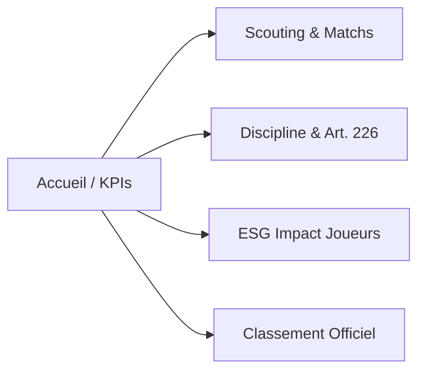

# ⚽ MATCHDAY • Guide de Démarrage & Notice d'Utilisation

> **Plateforme d'Aide à la Décision & Performance Sportive Certifiée FFF**  
> *Destinée aux Présidents, Directeurs Sportifs, Coachs Principaux et Éducateurs.*

---

## 🎯 1. Introduction : Qu'est-ce que MatchDay ?

**MatchDay** est une application web & mobile conçue spécifiquement pour les clubs de football régionaux et départementaux (de la Division 2 au Régional 1). 

Directement connectée aux bases officielles de la **Fédération Française de Football (FFF)**, la plateforme transforme vos feuilles de match en indicateurs d'aide à la décision tactique, financière et disciplinaire.

### Ce que MatchDay vous apporte au quotidien :
* 🔴 **Sécurité juridique & financière (Art. 226 FFF)** : Alerte automatique dès qu'un joueur approche d'une suspension (2 cartons jaunes sous sursis) pour éviter tout match perdu par pénalité et préserver la trésorerie du club.
* 📈 **Algorithme ESG Impact Score** : Classement objectif de l'impact réel de vos joueurs (temps de jeu effectif, solidité défensive, buts, discipline).
* 🎯 **Scouting & Préparation de match** : Analyse comparée de vos prochains adversaires en championnat et profil de sévérité de l'arbitre CRA désigné.
* 📱 **Application mobile instantanée (PWA)** : Accessible sans téléchargement lourd sur l'App Store / Play Store.

---

## 🚀 2. Comment Accéder à Votre Espace Club ?

L'accès à votre espace club est sécurisé par une **clé de licence officielle** et un **QR Code dédié**.

```
Lien d'accès direct : https://match-day-app.netlify.app/?key=VOTRE_CLE_DE_LICENCE
```

1. **Option A (Sur Smartphone)** : Scannez simplement le **QR Code** fourni avec votre document d'activation via l'appareil photo de votre téléphone.
2. **Option B (Sur Ordinateur ou Tablette)** : Cliquez sur le lien d'accès ci-dessus ou collez votre clé de licence dans le champ d'accueil.
3. Votre tableau de bord s'ouvre instantanément. **Aucun mot de passe complexe à créer ni à retenir.**

---

## 📲 3. Installer MatchDay sur Votre Téléphone (en 10 secondes)

MatchDay est une **Progressive Web App (PWA)**. Elle s'installe directement sur votre écran d'accueil sans occuper d'espace de stockage superflu.

### 🍏 Sur iPhone (Apple Safari) :
1. Ouvrez le lien de votre club dans **Safari**.
2. Appuyez sur le bouton **Partager** (le carré avec la flèche vers le haut, en bas de l'écran).
3. Faites défiler vers le bas et touchez **« Sur l'écran d'accueil »** (ou *« Ajouter à l'écran d'accueil »*).
4. Touchez **« Ajouter »** en haut à droite.
5. L'icône officielle MatchDay apparaît sur votre écran d'accueil comme une application native.

### 🤖 Sur Android (Google Chrome) :
1. Ouvrez le lien de votre club dans **Chrome**.
2. Un bandeau **« Ajouter MatchDay à l'écran d'accueil »** apparaît en bas de l'écran (ou touchez les 3 points verticaux en haut à droite $\rightarrow$ *« Installer l'application »*).
3. Validez l'installation.

---

## 🧭 4. Les 5 Modules Essentiels de la Plateforme



### 1. 📊 Tableau de Bord & KPIs Clés
* **PPM (Points Par Match)** : Mesure précise de votre rythme de croisière en championnat.
* **Taux d'invincibilité** : Pourcentage de rencontres terminées sans défaite.
* **Matrice des Quarts d'Heure** : Visualisez vos périodes d'efficacité offensive maximale et vos temps faibles défensifs (ex: 15 dernières minutes).

### 2. ⚖️ Veille Disciplinaire & Trésorerie (Art. 226 FFF)
* Décompte exact des cartons jaunes reçus sur une période de **3 mois glissants**.
* **Statuts d'alerte** :
  * 🟢 **Casier Vierge / Averti** : Situation normale.
  * 🟠 **Sous Sursis Immédiat (2 cartons)** : Alerte vigilance orange ! Tout nouvel avertissement entraînera automatiquement 1 match de suspension ferme.
  * 🔴 **Suspendu Automatique (3 ou 4 cartons)** : Interdiction d'aligner le joueur sous peine de perte du match sur tapis vert.
* **Compteur Trésorerie** : Suivi des amendes FFF évitées (250 € par joueur suspendu non aligné).

### 3. ⭐ Effectif & Algorithme ESG Impact Score
* Chaque joueur est évalué selon une note sur 100 calculée sur des faits de jeu objectifs :
  * Volume de jeu & temps de jeu effectif (titularisations vs entrées en jeu)
  * Clean sheets collectives enregistrées lors de sa présence sur le terrain
  * Buts marqués et passes décisives
  * Malus disciplinaire (cartons jaunes et rouges)
* Attribution automatique de **badges tactiques** : *MVP / Cadre incontournable*, *Buteur d'élite*, *Roc défensif*, *Super-Sub / Impact player*, *Rotation d'effectif*.

### 4. 🔍 Préparation de Match & Scouting CRA
* **Fiche du Prochain Adversaire** : Position, forme récente, points forts, ratio buts marqués / encaissés.
* **Arbitre Désigné par la CRA** : Barème de sévérité régional (moyenne de cartons/match) et consigne tactique pour adapter le comportement de l'équipe dès la causerie d'avant-match.

### 5. 🏆 Classement Officiel Synchronisé FFF
* Tableau officiel complet de votre poule actualisé en temps réel avec mise en valeur de votre club.

---

## 👥 5. Gestion des Accès Staff & Confidentialité

* **Code Support Personnel** : Dès votre première connexion, votre appareil se voit attribuer un identifiant unique (ex: `#SC-01`, `#LSQN-01`).
* **Personnalisation de session** : Touchez l'icône 👥 en haut à droite pour afficher la liste des membres du staff connectés et nommer votre rôle (ex: *Coach Principal*, *Adjoint*, *Préparateur Physique*, *Analyste Vidéo*).
* **Respect strict de la vie privée (RGPD)** : MatchDay ne collecte **aucune coordonnée personnelle** (pas d'e-mail privé obligatoire, pas de géolocalisation, pas d'accès aux contacts).

---

## 📞 6. Assistance & Support Technique

Une question, un besoin d'ajustement ou une analyse spécifique pour votre prochain match ?

* **Développement & Contact** : Nino François
* **Procédure de support rapide** : En cas de question, communiquez simplement le **Code Support** affiché sur votre écran (ex: `#ROOT-01`, `#SC-01`) pour une prise en charge immédiate.

---
*MatchDay © 2026 • Données certifiées conformes aux règlements généraux de la FFF.*
